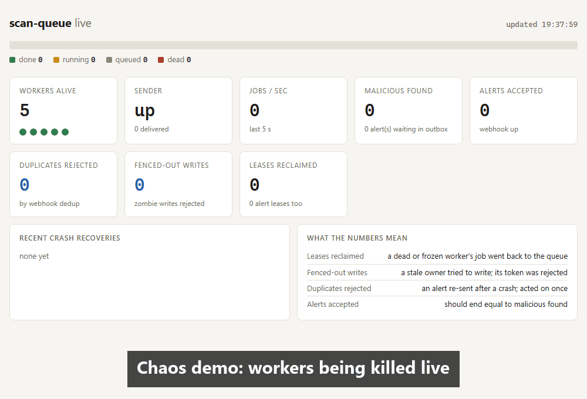
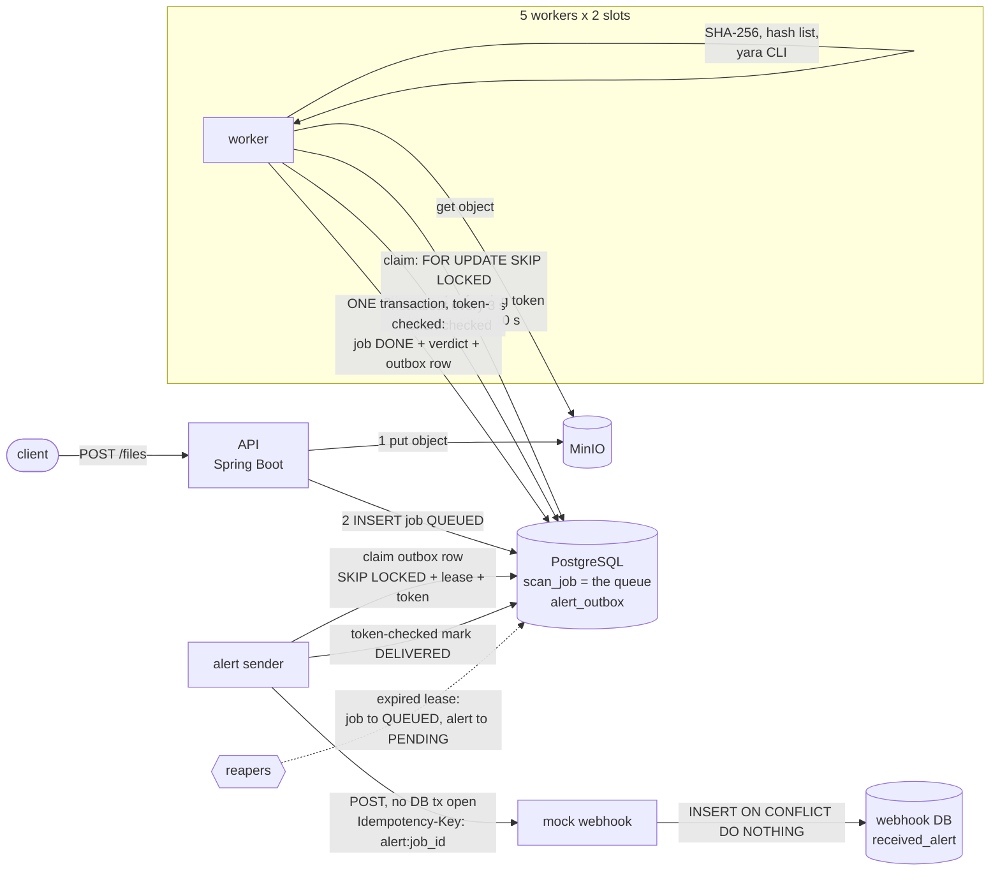

# scan-queue

A distributed file-scanning job queue in Java. Every uploaded file is scanned and
every malicious file raises exactly one alert, even when workers, the alert sender
and the alert receiver are killed at any moment. Postgres is the queue: jobs are
claimed with `SELECT … FOR UPDATE SKIP LOCKED` under leases timed by the database
clock. Every write after a claim is fenced by a claim token. Alerts go through a
transactional outbox to a receiver that deduplicates on a key derived from the
job. A chaos harness proves it: it kills workers and the sender in the middle of
real work, freezes lease holders into zombies, and restarts the receiver, then
checks every job and every alert against ground truth. An ablation study removes
each mechanism in turn and measures the failure it prevents.

**Every number in this README is generated from the result files in
[`results/`](results/) by the harness (`chaos.jar report | ablation-report |
headline`). The surrounding prose quotes those files and names its source.**

## Headline results

<!-- chaos:headline:begin -->
_Generated by `java -jar chaos/target/chaos.jar headline --out results/final` from 10 runs x 10000 files (5 workers, 1 sender)._

| | total over 10 runs |
|---|--:|
| jobs uploaded and acknowledged | 100000 |
| verdicts | 100000 |
| **jobs lost** (acknowledged, no verdict) | 0 |
| malicious (EICAR) jobs | 5000 |
| alerts accepted by the webhook | 5000 |
| **missing alerts** | 0 |
| **duplicate alerts accepted** | 0 |
| worker kills (`kill -9`) | 518 |
| ...confirmed to interrupt a live lease | 499 |
| sender kills (`kill -9`) | 140 |
| ...confirmed to interrupt an alert in flight | 135 |
| webhook kills + restarts | 30 |
| worker / sender freezes past the lease (zombies) | 19 |
| zombie writes fenced out | 23 |
| duplicate deliveries rejected by webhook dedup | 162 |
| pass/fail checks passed | 10 / 10 runs |

| latency (median of per-run values; range) | p50 | p95 |
|---|--:|--:|
| **processing**: final claim to committed verdict | 43 ms (27–45) | 92 ms (70–100) |
| queue wait: upload to first claim | 67290 ms (53596–81260) | 96717 ms (63721–110890) |
| end to end: upload to verdict | 67342 ms (53624–81316) | 96772 ms (63875–111182) |

Chaos runtime 40 min for 10 runs (excluding stack start-up); peak container memory 1459 MB.

<!-- chaos:headline:end -->



_The live dashboard during one demo round of 4,000 files, sped up about 2.7×.
Workers drop out and come back, the sender and webhook go down, and leases are
reclaimed; at the end, malicious found = alerts accepted. The demo is a
visualisation, not one of the measured runs above. It was recorded headlessly
by [`scripts/dev/make-dashboard-gif.sh`](scripts/dev/make-dashboard-gif.sh)._

## Architecture



All lease arithmetic uses Postgres `now()`, never a worker's clock. The job
reaper runs in every worker and the alert reaper in the sender. One codebase
(`scanner-app`) serves the `api`, `worker` and `sender` roles through Spring
profiles. `mock-webhook` is a separate service with its own database, like a
third-party receiver.

## What each safety mechanism prevents (ablation)

Same images, same seeds, same failure schedule. Each variant switches one
mechanism off (`scanqueue.ablation.*`, `webhook.dedup`; all default on).

<!-- chaos:ablation:begin -->
_Generated by `java -jar chaos/target/chaos.jar ablation-report --out results/ablation`. Each variant: 3 runs x 10000 files, same seeds and failure schedule. Cells: total (run 1 / run 2 / run 3)._

**What breaks when each mechanism is removed**

| variant | lost jobs | stuck jobs | duplicate/stale verdict writes accepted | missing alerts | duplicate alerts accepted | alerts for clean files | checks passed |
|---|--:|--:|--:|--:|--:|--:|--:|
| **A** final design | 0 (0 / 0 / 0) | 0 (0 / 0 / 0) | 0 (0 / 0 / 0) | 0 (0 / 0 / 0) | 0 (0 / 0 / 0) | 0 (0 / 0 / 0) | 3/3 |
| **B** no fencing (leases kept; writes not token-checked) | 0 (0 / 0 / 0) | 0 (0 / 0 / 0) | 1 (1 / 0 / 0) | 0 (0 / 0 / 0) | 0 (0 / 0 / 0) | 0 (0 / 0 / 0) | 2/3 |
| **C** no outbox (worker POSTs the alert after the verdict) | 0 (0 / 0 / 0) | 0 (0 / 0 / 0) | 0 (0 / 0 / 0) | 87 (36 / 33 / 18) | 0 (0 / 0 / 0) | 0 (0 / 0 / 0) | 0/3 |
| **D** no webhook dedup (outbox kept, duplicates accepted) | 0 (0 / 0 / 0) | 0 (0 / 0 / 0) | 0 (0 / 0 / 0) | 0 (0 / 0 / 0) | 46 (18 / 13 / 15) | 0 (0 / 0 / 0) | 0/3 |
| **E** naive (no lease reaper, no fencing, no outbox) | 292 (112 / 87 / 93) | 292 (112 / 87 / 93) | 0 (0 / 0 / 0) | 115 (32 / 48 / 35) | 0 (0 / 0 / 0) | 0 (0 / 0 / 0) | 0/3 |

**Safety work done and failures injected** (same seeds; the schedule is randomized from the seed but targets depend on live state, so counts differ slightly between variants)

| variant | second scans rejected by fencing | duplicates rejected by webhook | alerts dropped by worker | worker kills (confirmed in lease) | sender kills (confirmed in flight) | worker pauses | sender pauses | webhook restarts |
|---|--:|--:|--:|--:|--:|--:|--:|--:|
| **A** | 3 (3 / 0 / 0) | 36 (12 / 16 / 8) | 0 (0 / 0 / 0) | 177 (51 / 66 / 60) | 47 (14 / 16 / 17) | 2 (2 / 0 / 0) | 1 (0 / 1 / 0) | 9 (3 / 3 / 3) |
| **B** | 7 (0 / 3 / 4) | 38 (16 / 9 / 13) | 0 (0 / 0 / 0) | 201 (56 / 66 / 79) | 54 (16 / 19 / 19) | 5 (1 / 2 / 2) | 1 (0 / 0 / 1) | 9 (3 / 3 / 3) |
| **C** | 4 (1 / 0 / 3) | 1 (1 / 0 / 0) | 62 (23 / 26 / 13) | 194 (67 / 60 / 67) | 0 (0 / 0 / 0) | 4 (1 / 1 / 2) | 0 (0 / 0 / 0) | 9 (3 / 3 / 3) |
| **D** | 4 (0 / 0 / 4) | 0 (0 / 0 / 0) | 0 (0 / 0 / 0) | 229 (84 / 74 / 71) | 56 (19 / 19 / 18) | 3 (1 / 0 / 2) | 3 (1 / 1 / 1) | 9 (3 / 3 / 3) |
| **E** | 0 (0 / 0 / 0) | 0 (0 / 0 / 0) | 93 (24 / 41 / 28) | 0 (0 / 0 / 0) | 0 (0 / 0 / 0) | 2 (0 / 1 / 1) | 0 (0 / 0 / 0) | 9 (3 / 3 / 3) |

**Failed checks**

- B run 1: no second completed scan changed a result: 0 second scans rejected (0 disagree), 1 stale-owner verdicts accepted
- C run 1: every malicious job has exactly one accepted alert: 500 malicious jobs, 36 missing, 0 accepted more than once
- C run 2: every malicious job has exactly one accepted alert: 500 malicious jobs, 33 missing, 0 accepted more than once
- C run 3: every malicious job has exactly one accepted alert: 500 malicious jobs, 18 missing, 0 accepted more than once
- D run 1: every malicious job has exactly one accepted alert: 500 malicious jobs, 0 missing, 15 accepted more than once
- D run 1: zero duplicate alerts accepted: 518 accepted, 500 distinct keys, 18 extra acceptances
- D run 2: every malicious job has exactly one accepted alert: 500 malicious jobs, 0 missing, 13 accepted more than once
- D run 2: zero duplicate alerts accepted: 513 accepted, 500 distinct keys, 13 extra acceptances
- D run 3: every malicious job has exactly one accepted alert: 500 malicious jobs, 0 missing, 14 accepted more than once
- D run 3: zero duplicate alerts accepted: 515 accepted, 500 distinct keys, 15 extra acceptances
- E run 1: every acknowledged upload has exactly one final verdict: 10000 acknowledged, 112 without a verdict, 112 not DONE, 0 jobs with >1 verdict row
- E run 1: every malicious job has exactly one accepted alert: 494 malicious jobs, 32 missing, 0 accepted more than once
- E run 1: zero dead or stuck jobs and alerts: 0 dead, 112 jobs stuck QUEUED/RUNNING
- E run 2: every acknowledged upload has exactly one final verdict: 10000 acknowledged, 87 without a verdict, 87 not DONE, 0 jobs with >1 verdict row
- E run 2: every malicious job has exactly one accepted alert: 495 malicious jobs, 48 missing, 0 accepted more than once
- E run 2: zero dead or stuck jobs and alerts: 0 dead, 87 jobs stuck QUEUED/RUNNING
- E run 3: every acknowledged upload has exactly one final verdict: 10000 acknowledged, 93 without a verdict, 93 not DONE, 0 jobs with >1 verdict row
- E run 3: every malicious job has exactly one accepted alert: 493 malicious jobs, 35 missing, 0 accepted more than once
- E run 3: zero dead or stuck jobs and alerts: 0 dead, 93 jobs stuck QUEUED/RUNNING

<!-- chaos:ablation:end -->

Source: [`results/ablation/summary.md`](results/ablation/summary.md).

- **A, final design.** No failures in any run.
- **B, no fencing token → 1 stale verdict accepted in 3 runs.** Fencing
  protects a narrow window. B still requires `status = 'RUNNING'`, so a zombie
  that wakes after the job is already `DONE` is rejected anyway (7 such
  rejections in B). The token only matters when the zombie writes while the job
  is `RUNNING` under its new owner. With 13 s freezes and re-scans that take
  tens of milliseconds, the harness hit that window once. The committed verdict
  carries a claim token older than the job's current attempt, i.e. a
  superseded owner's write won. The logs do not show whether the newer owner's
  write was then rejected or never happened because it had been killed. The
  verdict content was still correct because scanning is deterministic. With a
  non-deterministic result (rules updated mid-flight, a flaky scanner), the
  stale result would win.
- **C, no outbox → 87 missing alerts, 0 of 3 runs pass.** The worker POSTs the
  alert itself after committing the verdict (3 tries, in memory). 62 alerts
  were recorded as dropped after the tries failed. The other 25 have no drop
  event, which fits a worker killed between the commit and the POST, where
  nothing durable remembers the alert.
- **D, no webhook dedup → 46 duplicate alerts accepted, 0 of 3 runs pass.**
  These are the same resends that A's webhook rejects (36 in A's 3 runs).
  The outbox gives at-least-once delivery; without dedup, "at least once" turns
  into "more than once".
- **E, naive → 292 acknowledged uploads never scanned and 115 alerts missing.**
  Without a reaper, every job a killed worker held stays `RUNNING` forever.
  Without the outbox, alerts are lost as in C. E shows 0 stale verdicts and 0
  "confirmed" kills only because nothing is ever re-claimed and no lease ever
  expires.

## Latency

The headline is **processing time**: from the final claim to the committed
verdict, i.e. what one scan costs (median p50 43 ms, median p95 92 ms over the
10 runs; the table above has the ranges). Queue wait is reported separately
because it measures load, not the system. The harness uploads 10,000 files with
12 client threads in 69–116 s per run, faster than 5 workers × 2 slots scan them on
this laptop, so most jobs wait in the queue for about a minute (median p50 67 s).
End-to-end latency is almost entirely that wait. Jobs whose first claim was
killed or frozen lose about one lease (median 10.4 s) between first and final
claim. Sources: the Latency table in
[`results/final/summary.md`](results/final/summary.md); upload timing is in
[`results/final/harness.log`](results/final/harness.log) ("uploading" to
"uploads done").

## How it works

### The job queue (`scan_job`)

| Step | SQL (abridged) |
|---|---|
| Upload | put the object in MinIO **first**, then `INSERT … status='QUEUED'`; a worker can never claim a job whose bytes are missing |
| Claim | `WITH next AS (SELECT id … WHERE status='QUEUED' AND available_at<=now() ORDER BY created_at LIMIT 1 FOR UPDATE SKIP LOCKED) UPDATE … SET status='RUNNING', attempts=attempts+1, lease_expires_at=now()+10 s` |
| Heartbeat | every 3 s: `UPDATE … SET lease_expires_at=now()+10 s WHERE id=? AND attempts=<token> AND status='RUNNING'`; 0 rows = lease lost, scan cancelled |
| Scan | download, SHA-256, `known_bad_hash` lookup, `yara` CLI with [`rules.yar`](scanner-app/src/main/resources/yara/rules.yar); `MALICIOUS` if either matches |
| Finish | **one transaction**: `UPDATE … SET status='DONE' WHERE id=? AND attempts=<token> AND status='RUNNING'`, then the verdict row, then (if malicious) the outbox row. 0 rows = fenced out, nothing written |
| Failure | same fence; re-queue with linear backoff, or `DEAD` once `attempts >= max_attempts` (5) |
| Reaper | in every worker, every 1 s: `RUNNING` rows with `lease_expires_at < now()` go back to `QUEUED` (or `DEAD` on the last attempt), with an event row in the same statement |

`attempts` is the **fencing token**. Every claim increments it, so a worker
that stalls past its lease and wakes up after someone else re-claimed the job
presents a stale token, and every write it tries matches 0 rows.

### Alerts: transactional outbox → sender → idempotent webhook

1. The malicious verdict and its `alert_outbox` row commit in the worker's
   fenced transaction. The alert exists if and only if the verdict does.
2. The sender claims one outbox row (`SKIP LOCKED`, lease 15 s, token
   `attempts+1`) and commits, then POSTs **with no database transaction open**,
   with `Idempotency-Key: alert:<job_id>`. Then it marks the row `DELIVERED`
   with a token-checked update. Failures back off exponentially on the DB
   clock (500 ms doubling, capped at 30 s); after 20 attempts the alert is
   `DEAD`.
3. The webhook does `INSERT … ON CONFLICT (idempotency_key) DO NOTHING` in its
   own database: 1 row means `201 accepted`, 0 rows means `200
   duplicate_rejected`. Both count as success to the sender.

**Why "at-least-once delivery + idempotency = effectively exactly once".**
Exactly-once *delivery* over a network is impossible. After a POST, the sender
can crash or lose the response before recording success, and from its side
"the receiver got it" looks the same as "it didn't" (the Two Generals problem).
So the guarantee is split in two. Delivery is *at least once*: the outbox row
cannot be lost, and it stays undelivered until a 2xx is recorded. Processing
is *idempotent*: every resend carries the same job-derived key, and the
receiver keeps keys under a unique constraint, so it acts on the first copy
only, across restarts and concurrent copies. Messages may be delivered more
than once but are processed exactly once, which is what "exactly once" means
in Kafka, Stripe's API and similar systems. The ablation shows both halves are
needed: without the outbox, alerts go missing (C); without dedup, duplicates get
through (D).

Full rationale and rejected alternatives: [`docs/design.md`](docs/design.md).

## How to run it

Requirements: Docker (Compose v2), JDK 21 (Maven comes from the wrapper), bash
(Git Bash on Windows).

```bash
./mvnw verify                 # builds everything; 28 unit + container tests (Testcontainers)
docker compose up -d --build  # postgres, minio, api, 3 workers, sender, webhook
bash scripts/smoke-phase1.sh  # upload a harmless file and the EICAR test string
bash scripts/demo-phase2.sh   # 1,000 files, kill -9 a busy worker, watch the lease come back
bash scripts/demo-phase3.sh   # 400 files, kill -9 the sender mid-delivery, reconcile alerts
docker compose down
```

Ports: API `8080` (dashboard at `/`), webhook `8090`, MinIO `9000/9001`, and
Postgres on **`55432`** (not 5432, so it doesn't clash with a locally installed
Postgres).

### Live dashboard and demo

`http://localhost:8080/` refreshes every second. It shows job counts by status,
workers and sender alive (heartbeat within 3 s), jobs/sec, malicious found,
alerts accepted, duplicates rejected, fenced-out writes, lease reclaims, and a
feed of recent recoveries.

```bash
./mvnw package -DskipTests && docker compose build
bash scripts/demo-dashboard.sh   # starts the stack, counts down, then ~2 minutes of chaos
```

The demo runs one chaos round of 4,000 files (`FILES=…` to change) with the
same failure injection as the full test, then verifies and prints the checks.
Its output goes to `results/demo/` (not committed).

`scripts/dev/make-dashboard-gif.sh` regenerates `docs/dashboard.gif` with no
screen recording. It runs the demo, screenshots the page once a second with
headless Chromium (Playwright), and builds a palette-optimised GIF with ffmpeg.
Playwright and ffmpeg are installed into `~/.cache/scan-queue-gif-tools`, never
into the project.

### Chaos harness

```bash
./mvnw package -DskipTests && docker compose build
bash scripts/run-all-chaos.sh   # Phase 4 + Phase 5 + regenerate every table in this README
```

- **Runtime:** the 10 final runs took 41 min and the 15 ablation runs 91 min
  (timestamps in [`results/final/harness.log`](results/final/harness.log) and
  [`results/ablation/harness.log`](results/ablation/harness.log)).
- **RAM:** before running, the harness checks that the containers' `mem_limit`
  sum plus its own heap fits in 4 GB (logged: 2,844 MB + 356 MB = 3,200 MB),
  and it aborts a run if live container memory passes 3.5 GB. Measured peak
  container memory was 1,459 MB (`results/final/summary.md`).

Single steps:

```bash
java -Xmx256m -jar chaos/target/chaos.jar run --runs 10 --files 10000 --out results/final
java -Xmx256m -jar chaos/target/chaos.jar ablation --runs 3 --files 10000 --out results/ablation
java -jar chaos/target/chaos.jar report          --out results/final    --readme README.md
java -jar chaos/target/chaos.jar ablation-report --out results/ablation --readme README.md
java -jar chaos/target/chaos.jar headline        --out results/final    --readme README.md
```

## The chaos test

Each run resets the tables, uploads 10,000 files (every 20th is the EICAR test
string) and injects failures throughout the scan phase:

| Failure | Aimed at |
|---|---|
| `kill -9` a worker, every 1.5–3.5 s | only a worker holding a **live** job lease right now; restarted 1–3 s later |
| `kill -9` the sender, every 3–6 s | only while an alert is **in flight** (row `SENDING` under the live sender's lease) |
| `kill -9` + restart the webhook, 3 per run | preferably while an alert is in flight |
| `docker pause` a worker (2×) and the sender (1×) for lease + 3 s | a lease holder, frozen until its lease is reclaimed: a **zombie** whose late write must be fenced |

A lease is "live" only if it was set after the harness last restarted that
container, because a restarted container keeps its hostname. A kill is
**confirmed** when a lease it interrupted later expires. Each expiry is
attributed to the failure between that lease's last renewal and its expiry
(expiry events store `lease_expires_at`). All timestamps come from the
Postgres clock.

Pass/fail checks: every acknowledged upload has exactly one final verdict;
every verdict matches ground truth; no second completed scan changed a result
(no stale-owner verdict accepted, and every fenced verdict agrees with the
committed one); every malicious job has exactly one accepted alert; zero alerts
for clean files; zero duplicate alerts accepted; zero dead or stuck jobs and
alerts.

### Full results: final design, 10 runs × 10,000 files

Raw per-run data (every kill with its DB-clock timestamp and the leases it
held): [`results/final/run-*.json`](results/final/).

<!-- chaos:final:begin -->
_Generated by `java -jar chaos/target/chaos.jar report --out results/final` from 10 run files. 10000 files per run (every 20th is EICAR), 5 workers, 1 sender, webhook response delay 200 ms._

**Correctness**

| metric | r1 | r2 | r3 | r4 | r5 | r6 | r7 | r8 | r9 | r10 | total |
|---|--:|--:|--:|--:|--:|--:|--:|--:|--:|--:|--:|
| jobs | 10000 | 10000 | 10000 | 10000 | 10000 | 10000 | 10000 | 10000 | 10000 | 10000 | 100000 |
| verdicts | 10000 | 10000 | 10000 | 10000 | 10000 | 10000 | 10000 | 10000 | 10000 | 10000 | 100000 |
| malicious | 500 | 500 | 500 | 500 | 500 | 500 | 500 | 500 | 500 | 500 | 5000 |
| alerts accepted | 500 | 500 | 500 | 500 | 500 | 500 | 500 | 500 | 500 | 500 | 5000 |
| duplicates rejected | 15 | 10 | 20 | 21 | 20 | 19 | 11 | 14 | 20 | 12 | 162 |
| fenced-out writes | 2 | 0 | 3 | 3 | 3 | 2 | 4 | 2 | 2 | 2 | 23 |
| job lease expiries | 60 | 63 | 90 | 102 | 112 | 108 | 89 | 104 | 86 | 96 | 910 |
| alert lease expiries | 16 | 19 | 27 | 30 | 30 | 27 | 28 | 28 | 27 | 28 | 260 |
| dead jobs | 0 | 0 | 0 | 0 | 0 | 0 | 0 | 0 | 0 | 0 | 0 |
| dead alerts | 0 | 0 | 0 | 0 | 0 | 0 | 0 | 0 | 0 | 0 | 0 |
| all checks | PASS | PASS | PASS | PASS | PASS | PASS | PASS | PASS | PASS | PASS | 10/10 |

**Latency** (headline: processing = final claim to committed verdict. Queue wait = upload to first claim. End to end = upload to verdict, which also includes time lost to crashes. DB clock)

| metric | r1 | r2 | r3 | r4 | r5 | r6 | r7 | r8 | r9 | r10 | min / median / max |
|---|--:|--:|--:|--:|--:|--:|--:|--:|--:|--:|--:|
| processing p50 ms | 27 | 30 | 44 | 45 | 43 | 43 | 43 | 44 | 43 | 45 | 27 / 43 / 45 |
| processing p95 ms | 70 | 73 | 90 | 92 | 91 | 100 | 90 | 94 | 92 | 93 | 70 / 92 / 100 |
| queue wait p50 ms | 53596 | 58746 | 62762 | 67290 | 81260 | 78948 | 72304 | 79423 | 66754 | 62531 | 53596 / 67290 / 81260 |
| queue wait p95 ms | 63721 | 70034 | 86779 | 93985 | 110890 | 106010 | 88743 | 102796 | 96828 | 96717 | 63721 / 96717 / 110890 |
| end-to-end p50 ms | 53624 | 58898 | 62843 | 67342 | 81316 | 79011 | 72513 | 79470 | 66803 | 62585 | 53624 / 67342 / 81316 |
| end-to-end p95 ms | 63875 | 70181 | 86831 | 94197 | 111182 | 106222 | 88989 | 102848 | 96928 | 96772 | 63875 / 96772 / 111182 |
| jobs re-claimed after a crash/freeze | 59 | 63 | 88 | 102 | 108 | 107 | 86 | 104 | 86 | 96 | 59 / 96 / 108 |
| their first-to-final claim delay p50 ms | 10442 | 10396 | 10407 | 10427 | 10404 | 10489 | 10376 | 10445 | 10442 | 10463 | 10376 / 10442 / 10489 |
| jobs/sec | 69.4 | 66.2 | 50.6 | 46.4 | 44.1 | 42.5 | 49.6 | 46.8 | 49.3 | 47.5 | 42.5 / 49.3 / 69.4 |
| peak container MB | 1360 | 1390 | 1408 | 1384 | 1416 | 1406 | 1415 | 1417 | 1420 | 1459 | 1360 / 1415 / 1459 |

**Recovery** (per kill: from the SIGKILL to the last item it interrupted being finished elsewhere. Segments: medians over interrupted items that were not interrupted again)

| metric | r1 | r2 | r3 | r4 | r5 | r6 | r7 | r8 | r9 | r10 | min / median / max |
|---|--:|--:|--:|--:|--:|--:|--:|--:|--:|--:|--:|
| worker recovery p50 ms | 10605 | 10588 | 10569 | 10592 | 10546 | 10689 | 10552 | 10565 | 10629 | 10651 | 10546 / 10592 / 10689 |
| worker recovery max ms | 20648 | 13665 | 21259 | 13213 | 24737 | 20805 | 23895 | 14266 | 15681 | 11400 | 11400 / 20648 / 24737 |
| job: kill -> lease expiry | 10117 | 10119 | 10122 | 10119 | 10107 | 10107 | 10113 | 10110 | 10114 | 10111 | 10107 / 10114 / 10122 |
| job: lease expiry -> reaped | 421 | 375 | 339 | 396 | 360 | 451 | 317 | 385 | 418 | 380 | 317 / 385 / 451 |
| job: reaped -> re-claimed | 28 | 32 | 31 | 28 | 33 | 34 | 35 | 32 | 30 | 30 | 28 / 32 / 35 |
| job: re-claimed -> verdict | 38 | 36 | 44 | 50 | 44 | 45 | 48 | 42 | 45 | 44 | 36 / 44 / 50 |
| alert recovery p50 ms | 24398 | 27505 | 26523 | 36581 | 25405 | 25975 | 40750 | 36249 | 25495 | 35697 | 24398 / 27505 / 40750 |
| alert recovery max ms | 58376 | 92343 | 101494 | 91702 | 112927 | 116442 | 111502 | 126327 | 109479 | 98702 | 58376 / 109479 / 126327 |
| alert: kill -> lease expiry | 15030 | 14984 | 14983 | 15013 | 14975 | 14942 | 14983 | 14984 | 15054 | 14977 | 14942 / 14984 / 15054 |
| alert: lease expiry -> reaped | 5871 | 7143 | 10018 | 8416 | 9570 | 9532 | 9323 | 8834 | 9558 | 8827 | 5871 / 9323 / 10018 |
| alert: reaped -> re-claimed | 390 | 533 | 461 | 479 | 454 | 458 | 460 | 505 | 485 | 523 | 390 / 479 / 533 |
| alert: re-claimed -> delivered | 225 | 244 | 240 | 245 | 234 | 238 | 247 | 236 | 261 | 231 | 225 / 240 / 261 |
| alerts interrupted | 14 | 19 | 25 | 30 | 30 | 26 | 28 | 28 | 27 | 26 | 14 / 27 / 30 |
| ...of which interrupted again | 1 | 7 | 1 | 11 | 5 | 4 | 12 | 13 | 4 | 6 | 1 / 6 / 13 |
| ...their kill -> delivered p50 ms | 58376 | 63905 | 52601 | 48429 | 85137 | 98998 | 68744 | 96966 | 47576 | 60896 | 47576 / 63905 / 98998 |

**Chaos** (observed = lease seen held in the DB right before SIGKILL; confirmed = that container's lease later expired, i.e. the kill interrupted real work; pauses = `docker pause` for lease + 3 s while holding a lease, then unpause: the zombie whose late write must be fenced)

| metric | r1 | r2 | r3 | r4 | r5 | r6 | r7 | r8 | r9 | r10 | total |
|---|--:|--:|--:|--:|--:|--:|--:|--:|--:|--:|--:|
| worker kills | 37 | 38 | 50 | 57 | 61 | 62 | 51 | 56 | 51 | 55 | 518 |
| worker kills holding a lease (observed) | 37 | 38 | 50 | 57 | 61 | 62 | 51 | 56 | 51 | 55 | 518 |
| worker kills holding a lease (confirmed) | 35 | 37 | 50 | 54 | 60 | 60 | 48 | 54 | 49 | 52 | 499 |
| sender kills | 8 | 10 | 13 | 16 | 17 | 16 | 15 | 15 | 15 | 15 | 140 |
| sender kills with alert in flight (observed) | 8 | 10 | 13 | 16 | 17 | 16 | 15 | 15 | 15 | 15 | 140 |
| sender kills with alert in flight (confirmed) | 8 | 10 | 13 | 16 | 16 | 14 | 15 | 15 | 14 | 14 | 135 |
| webhook restarts | 3 | 3 | 3 | 3 | 3 | 3 | 3 | 3 | 3 | 3 | 30 |
| webhook restarts with alert in flight (observed) | 1 | 0 | 2 | 0 | 0 | 0 | 0 | 0 | 1 | 0 | 4 |
| worker pauses (zombies) | 1 | 0 | 1 | 2 | 2 | 1 | 2 | 1 | 2 | 2 | 14 |
| worker pauses whose lease was reclaimed | 1 | 0 | 1 | 2 | 2 | 1 | 2 | 1 | 2 | 1 | 13 |
| sender pauses (zombies) | 1 | 0 | 1 | 1 | 0 | 1 | 0 | 0 | 0 | 1 | 5 |
| sender pauses whose lease was reclaimed | 1 | 0 | 1 | 0 | 0 | 1 | 0 | 0 | 0 | 1 | 4 |
| heartbeats that found the lease gone | 0 | 0 | 0 | 3 | 2 | 1 | 3 | 2 | 2 | 1 | 14 |
| unattributed lease expiries | 0 | 0 | 0 | 0 | 0 | 0 | 0 | 0 | 0 | 0 | 0 |
| upload client retries | 0 | 0 | 0 | 0 | 0 | 0 | 0 | 0 | 0 | 0 | 0 |

**Pass/fail checks**

| check | r1 | r2 | r3 | r4 | r5 | r6 | r7 | r8 | r9 | r10 |
|---|:-:|:-:|:-:|:-:|:-:|:-:|:-:|:-:|:-:|:-:|
| every acknowledged upload has exactly one final verdict | PASS | PASS | PASS | PASS | PASS | PASS | PASS | PASS | PASS | PASS |
| every verdict matches ground truth (EICAR -> MALICIOUS, else CLEAN) | PASS | PASS | PASS | PASS | PASS | PASS | PASS | PASS | PASS | PASS |
| no second completed scan changed a result | PASS | PASS | PASS | PASS | PASS | PASS | PASS | PASS | PASS | PASS |
| every malicious job has exactly one accepted alert | PASS | PASS | PASS | PASS | PASS | PASS | PASS | PASS | PASS | PASS |
| zero alerts for non-malicious jobs | PASS | PASS | PASS | PASS | PASS | PASS | PASS | PASS | PASS | PASS |
| zero duplicate alerts accepted | PASS | PASS | PASS | PASS | PASS | PASS | PASS | PASS | PASS | PASS |
| zero dead or stuck jobs and alerts | PASS | PASS | PASS | PASS | PASS | PASS | PASS | PASS | PASS | PASS |

<!-- chaos:final:end -->

### Reading the results

Source for everything below: [`results/final/summary.md`](results/final/summary.md)
(median column unless stated).

- **The kills hit real work.** 499 of 518 worker kills and 135 of 140 sender
  kills were confirmed to have interrupted a live lease, and no lease expiry was
  left unattributed.
- **Fenced-out writes come from the zombies.** A process killed with `kill -9`
  never writes again; frozen processes do. All 23 zombie writes were rejected by
  the token check, and every rejected verdict agreed with the committed one.
  Some planned freezes are skipped when the kill loop happened to kill the same
  container first, so freeze counts vary by run.
- **Worker recovery ≈ the lease: about 10.6 s.** Median segments: kill → lease
  expiry 10.1 s, expiry → reaped 0.39 s, reaped → re-claimed 0.03 s,
  re-claimed → verdict 0.04 s.
- **Alert recovery: about 27.5 s.** See the first item under Limitations.

## Limitations

- **The alert reaper runs only in the sender, which adds about 9 s to alert
  recovery.** Measured median segments for an interrupted alert: kill → lease
  expiry 15.0 s (the alert lease), **lease expiry → reaped 9.3 s**, reaped →
  re-claimed 0.48 s, re-claimed → delivered 0.24 s. Jobs and alerts both reap
  every second. For jobs, expiry → reaped is 0.39 s, because all 5 workers reap
  jobs. The only alert reaper lives in the single sender, which the chaos test
  kills every 3–6 s; every restart costs a 1–3 s delay plus a JVM boot, so for
  long stretches no live process is reaping alerts. A median of 6 of about 27
  interrupted alerts per run were interrupted again before delivery and took
  about 64 s. **Fix:** run the alert reaper in the workers too (it is
  idempotent and `SKIP LOCKED`), or run two senders. Correctness is unaffected:
  alerts are late, never lost or doubled. (Recovery table in
  `results/final/summary.md`.)
- **Throughput varies between runs: 42.5–69.4 jobs/s, median 49.3.** The first
  two runs ran at 66–69 jobs/s and the other eight at 42–51. Kills are paced per
  second, so a slower run also takes more kills, which slows it further. Why the
  later runs started slower is not established. The laptop also runs everything
  else: 10 JVM/database containers plus the harness. These are not benchmark
  numbers.
- **B's window is rare in this setup.** The ablation hit the fencing window once
  in 3 runs (see above). The harness freezes for lease + 3 s, which mostly lands
  after the re-scan has finished. Freezes timed to end mid-re-scan would hit it
  more often; the test was not tuned to make it fail.
- **No transaction is held across a network call any more.** The sender used to
  hold a row lock across the POST (rejected; see design.md). What remains is
  short and local: the worker's finish transaction (job + verdict + outbox row),
  the sender's mark transaction, and the webhook's insert. The heartbeat and
  presence updates borrow a pool connection for one statement. Each worker
  process has a pool of 4 connections for 2 claim loops plus heartbeat,
  reaper and presence. A slow database therefore slows workers, but nothing
  waits on the network while holding a lock.
- **Retry caps.** Jobs: 5 claims, then `DEAD` (a crash during a claim counts),
  with linear backoff of 2 s × attempts after a failed scan. Alerts: 20 claims,
  then `DEAD`, with exponential backoff of 500 ms doubling, capped at 30 s
  (about 7 minutes of backoff in total). Dead items need a human; the chaos runs ended
  with 0 of each.
- **Orphan objects.** The upload stores the file before inserting the job row.
  If the insert fails, the object stays in MinIO, harmless and never scanned.
  No cleanup job exists.
- **Single Postgres.** The queue, outbox and events share one database with no
  replication. Postgres is the single point of failure and the throughput
  ceiling. That is the deliberate trade-off (see design.md: DB queue vs Kafka).
- **Windows / Docker Desktop notes.**
  - Docker Desktop's VM can stall as a whole under load. An earlier series of
    runs had one (commit `3e1b081`, `results/final/log-silence.txt`), and `scripts/log-silence.sh` exists to detect it from the
    webhook's log gaps.
  - `docker kill` through the Windows CLI is not instant, so a held lease can
    finish between the harness's snapshot and the kill. That's why the report
    separates *observed* from *confirmed* kills.
  - Port forwarding occasionally resets a connection under concurrent uploads.
    The harness retries uploads and counts only acknowledged ones (0 retries
    were needed in the final runs).
  - The official `minio/minio` images are no longer published; Compose uses
    Chainguard's build of the same server, pinned by digest.
  - Docker Engine 29 needs Testcontainers 2.x.
  - The MinIO Java client needs `okhttp-jvm` declared explicitly under Maven.

## Safety

No real malware is used anywhere. The "malicious" sample is the
[EICAR test string](https://www.eicar.org/download-anti-malware-testfile/),
which antivirus products detect by design and which is harmless. It is never
stored whole in this repository. The YARA rule encodes it as hex, and scripts
and tests assemble it at runtime from two halves. The hash list contains
EICAR's SHA-256 and three hashes of harmless made-up strings.

## Repository layout

| Path | What |
|---|---|
| `scanner-app/` | API, worker and sender roles; Flyway migrations V1–V7; YARA rules |
| `mock-webhook/` | alert receiver with durable idempotency-key dedup |
| `chaos/` | chaos harness, verifier and report generator |
| `results/final/`, `results/ablation/` | raw per-run JSON, logs and generated summaries |
| `scripts/` | smoke tests, demos, `run-all-chaos.sh`, `log-silence.sh` |
| `docs/design.md` | every design decision, with the alternatives rejected and why |
